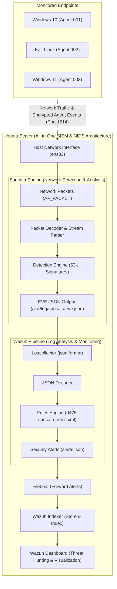

# Suricata NIDS + Wazuh SIEM | SOC Detection Engineering Lab

<p align="center">
  
  
  
  
  
</p>

A hands-on detection engineering lab demonstrating the deployment, configuration, and end-to-end integration of **Suricata High-Performance Network IDS** on an existing **Ubuntu Wazuh All-in-One Server**. Network packets are captured, decoded, and matched against threat signatures in near-real time, before being normalized into EVE JSON and parsed into the Wazuh SIEM for automated threat hunting, correlation, and SOC dashboard investigation.

> [!IMPORTANT]
> **Deployment Model (Co-located Architecture):** Suricata runs directly on the Wazuh Manager host (`wazuh-server`). The Wazuh Manager's built-in, local **Logcollector** daemon natively monitors Suricata's `eve.json` output via a `<localfile>` configuration. A separate, redundant `wazuh-agent` daemon is **not** required on the Manager server.

---

## Table of Contents

- [1. Executive Summary & Topology](#1-executive-summary--topology)
- [2. System Architecture & Data Flow](#2-system-architecture--data-flow)
  - [2.1 High-Level Architecture Diagram](#21-high-level-architecture-diagram)
  - [2.2 Detailed Event Pipeline](#22-detailed-event-pipeline)
  - [2.3 Component Responsibility Matrix](#23-component-responsibility-matrix)
- [3. Environment & Network Specifications](#3-environment--network-specifications)
- [4. Phase 1: Suricata Installation & Interface Tuning](#4-phase-1-suricata-installation--interface-tuning)
  - [4.1 Installing Suricata 8.0.x via OISF PPA](#41-installing-suricata-80x-via-oisf-ppa)
  - [4.2 Configuring Network Variables (`HOME_NET`)](#42-configuring-network-variables-home_net)
  - [4.3 Configuring High-Speed Capture (`AF_PACKET`)](#43-configuring-high-speed-capture-af_packet)
  - [4.4 Configuring EVE JSON Telemetry Output](#44-configuring-eve-json-telemetry-output)
  - [4.5 Validating Suricata Configuration Syntax](#45-validating-suricata-configuration-syntax)
- [5. Phase 2: Threat Feeds & Ruleset Management](#5-phase-2-threat-feeds--ruleset-management)
  - [5.1 Enabling Threat Intelligence Feeds](#51-enabling-threat-intelligence-feeds)
  - [5.2 Building & Compiling the Ruleset](#52-building--compiling-the-ruleset)
- [6. Phase 3: Service Validation & Runtime Telemetry](#6-phase-3-service-validation--runtime-telemetry)
  - [6.1 Starting the Suricata Engine](#61-starting-the-suricata-engine)
  - [6.2 Inspecting Live EVE JSON Events](#62-inspecting-live-eve-json-events)
- [7. Phase 4: Integrating Suricata with Wazuh Manager](#7-phase-4-integrating-suricata-with-wazuh-manager)
  - [7.1 Configuring Manager's Local Logcollector (`ossec.conf`)](#71-configuring-managers-local-logcollector-ossecconf)
  - [7.2 Restarting the Manager & Validating Ingestion](#72-restarting-the-manager--validating-ingestion)
- [8. Phase 5: Alert Forwarding & Indexing Pipeline](#8-phase-5-alert-forwarding--indexing-pipeline)
  - [8.1 Filebeat Alert Forwarding (Default)](#81-filebeat-alert-forwarding-default)
  - [8.2 Optional: Archiving Raw Telemetry](#82-optional-archiving-raw-telemetry)
- [9. Phase 6: Threat Hunting in Wazuh Dashboard](#9-phase-6-threat-hunting-in-wazuh-dashboard)
  - [9.1 Accessing the Threat Hunting Interface](#91-accessing-the-threat-hunting-interface)
  - [9.2 Key Search Queries](#92-key-search-queries)
  - [9.3 Decoded Field Reference](#93-decoded-field-reference)
- [10. Phase 7: Verification & Simulated Detection Testing](#10-phase-7-verification--simulated-detection-testing)
  - [10.1 Safe Network Ping & ICMP Visibility](#101-safe-network-ping--icmp-visibility)
  - [10.2 Signature Trigger Verification (TestMyNIDS)](#102-signature-trigger-verification-testmynids)
  - [10.3 Pipeline Health Check Matrix](#103-pipeline-health-check-matrix)
- [11. Operations, Maintenance & Service Lifecycle](#11-operations-maintenance--service-lifecycle)
- [12. Troubleshooting & Common Pitfalls](#12-troubleshooting--common-pitfalls)
- [13. Empirical Lab Evidence & Production Observations](#13-empirical-lab-evidence--production-observations)
- [14. Security Boundaries & Limitations](#14-security-boundaries--limitations)
- [15. References & Documentation](#15-references--documentation)

---

## 1. Executive Summary & Topology

Modern Security Operations Centers (SOCs) depend on multi-layered visibility across both host-level telemetry (EDR/HIDS) and network-level telemetry (NIDS). This lab establishes a cohesive security operations pipeline by pairing:

1. **Suricata (Network Layer):** Operates in passive capture mode (AF_PACKET) on network interface `ens33`. It inspects traffic, reconstructs network streams, evaluates traffic against over 53,500 signatures (Emerging Threats Open + OISF TrafficID), and writes JSON-structured records to `/var/log/suricata/eve.json`.
2. **Wazuh (SIEM & Log Correlation Layer):** Ingests Suricata's EVE JSON output through the native Wazuh Logcollector, parses fields using the built-in JSON decoder, runs the parsed event through rule evaluation (`0475-suricata_rules.xml`), and generates high-fidelity security alerts stored in `alerts.json`.
3. **Filebeat & Wazuh Indexer:** Forwards formatted alert documents to the distributed search index (`wazuh-alerts-*`).
4. **Wazuh Dashboard:** Provides interactive threat hunting, data querying, and visual dashboards for incident responders.

---

## 2. System Architecture & Data Flow

### 2.1 High-Level Architecture Diagram

The lab network consists of monitored enterprise endpoints alongside the central Ubuntu security server hosting Suricata and the full Wazuh SIEM stack:

<p align="center">
  
</p>

### 2.2 Detailed Event Pipeline

The end-to-end data pipeline moves telemetry from raw packet capture through analysis, storage, and visualization—all running unified on the Ubuntu Server:



### 2.3 Component Responsibility Matrix

| Component | Responsibility in this Lab | Input Source | Output Artifact |
|---|---|---|---|
| **Suricata Engine** | Raw packet sniffing, stream reassembly, signature evaluation, protocol parsing | `ens33` Promiscuous/AF_PACKET | `/var/log/suricata/eve.json` |
| **Wazuh Logcollector** | Real-time file monitoring, chunking, and local delivery to Wazuh analysis | `/var/log/suricata/eve.json` | Internal Wazuh Queue |
| **Wazuh JSON Decoder** | Dynamic schema extraction of nested JSON keys (`data.alert.*`, `data.src_ip`, etc.) | Internal Event Queue | Decoded Event Object |
| **Wazuh Rules Engine** | Matching against Wazuh IDS rule groups, severity scoring, alert filtering | Decoded Object | `/var/ossec/logs/alerts/alerts.json` |
| **Filebeat** | Resilient log shipping, TLS encryption, index template routing | `alerts.json` | Elasticsearch bulk API |
| **Wazuh Indexer** | High-performance document indexing, cluster search, index lifecycle | Filebeat bulk feed | `wazuh-alerts-4.x-*` index |
| **Wazuh Dashboard** | Visual threat hunting, Lucene/KQL filtering, event pivoting | Wazuh Indexer API | SOC Analyst UI |

> [!NOTE]
> **Suricata Signatures vs. Wazuh Rules:** Suricata signatures match network packet patterns and write an IDS alert to `eve.json`. The Wazuh Rules Engine then inspects this EVE record and applies secondary SIEM alert logic. An event in `eve.json` becomes a Wazuh alert only when matching a corresponding Wazuh rule (such as `rule.id: 86601`).

---

## 3. Environment & Network Specifications

### Host Environment Details

| Parameter | Lab Value | Description |
|---|---|---|
| **Server Hostname** | `wazuh-server` | Ubuntu Server running Wazuh All-in-One & Suricata |
| **Capture Interface** | `ens33` | Monitored network adapter (e.g., `ens33` / `eth0`) |
| **Server IP Address** | `192.168.1.100/24` | Example static / internal IP (`<wazuh-server-ip>`) |
| **Monitored Subnet (`HOME_NET`)** | `192.168.1.0/24` | Protected internal lab network CIDR |
| **Default Gateway** | `192.168.1.1` | Local virtual switch gateway |
| **Suricata Version** | `8.0.8` | High-performance multi-threaded NIDS |
| **Wazuh Stack Version** | `v4.14.9 (rc2)` | Wazuh Manager, Indexer, Dashboard, Filebeat |

### Monitored Endpoint Fleet

| System Name | Operating System | Wazuh Agent ID | Communication Channel | Role |
|---|---|:---:|---|---|
| **`wazuh-server`** | Ubuntu Server 22.04/24.04 | `000` | Local System / Logcollector | Central SIEM & NIDS Host |
| **`WIN11-SOC-HOST`** | Windows 11 Enterprise | `003` | TCP 1514 (AES Encrypted) | Monitored Host / Active |
| **`WIN10-SOC-LAB`** | Windows 10 Pro | `001` | TCP 1514 (AES Encrypted) | Monitored Host |
| **`KALI-SOC-LAB`** | Kali Linux Rolling | `002` | TCP 1514 (AES Encrypted) | Security Testing & Attack Emulation |

---

## 4. Phase 1: Suricata Installation & Interface Tuning

### 4.1 Installing Suricata 8.0.x via OISF PPA

To install the latest stable build of Suricata on Ubuntu:

```bash
# Update local packages and install prerequisites
sudo apt update
sudo apt install -y software-properties-common curl jq

# Add official OISF stable PPA
sudo add-apt-repository -y ppa:oisf/suricata-stable
sudo apt update

# Install Suricata engine
sudo apt install -y suricata
```

Verify the installed build:

```bash
suricata --version
# Expected: Suricata version 8.0.8 (or newer)

suricata --build-info
```

### 4.2 Configuring Network Variables (`HOME_NET`)

Create a backup of the default configuration file before editing:

```bash
sudo cp /etc/suricata/suricata.yaml /etc/suricata/suricata.yaml.backup
sudo nano /etc/suricata/suricata.yaml
```

Locate the `vars.address-groups` section and define your internal network boundary. Set `HOME_NET` to your internal network CIDR and define `EXTERNAL_NET` as everything outside `HOME_NET`:

```yaml
vars:
  address-groups:
    # Define your internal protected subnet
    HOME_NET: "[192.168.1.0/24]"
    EXTERNAL_NET: "!$HOME_NET"
```

> [!TIP]
> If your environment includes multiple VLANs or subnets, include them as a comma-separated list:
> ```yaml
> HOME_NET: "[192.168.1.0/24, 10.0.0.0/24, 172.16.0.0/16]"
> ```

### 4.3 Configuring High-Speed Capture (`AF_PACKET`)

Under the `af-packet:` block, bind Suricata to your active capture interface (`ens33`). Ensure modern parameters are set:

```yaml
af-packet:
  - interface: ens33
    cluster-id: 99
    cluster-type: cluster_flow
    defrag: yes
    tpacket-v3: yes
```

> [!WARNING]
> **Syntax Update in Suricata 8.x:** Use `tpacket-v3: yes` with a hyphen. The legacy underscore spelling `tpacket_v3` is deprecated in Suricata 8.0.8 and will throw configuration warnings during startup.

### 4.4 Configuring EVE JSON Telemetry Output

Verify or update the `outputs:` section to ensure `eve-log` is enabled and outputs all desired telemetry types to `/var/log/suricata/eve.json`:

```yaml
outputs:
  - eve-log:
      enabled: yes
      filetype: regular
      filename: eve.json
      types:
        - alert:
            metadata: yes
        - anomaly
        - dns
        - flow
        - http
        - tls
```

### 4.5 Validating Suricata Configuration Syntax

Always test the configuration before starting or restarting the service:

```bash
sudo suricata -T -c /etc/suricata/suricata.yaml
```

**Expected output:**
```text
Configuration provided was successfully loaded. Exiting.
```
Confirm return code is `0`:
```bash
echo $?
# 0
```

---

## 5. Phase 2: Threat Feeds & Ruleset Management

### 5.1 Enabling Threat Intelligence Feeds

Suricata includes `suricata-update`, a robust rule management tool that handles automated ruleset retrieval, updating, and compilation.

```bash
# Update the index of rule sources
sudo suricata-update update-sources

# List available and enabled sources
sudo suricata-update list-sources
sudo suricata-update list-enabled-sources
```

Enable the **Emerging Threats Open** ruleset and the **OISF TrafficID** ruleset:

```bash
sudo suricata-update enable-source et/open
sudo suricata-update enable-source oisf/trafficid
```

### 5.2 Building & Compiling the Ruleset

Run `suricata-update` to fetch, sanitize, and compile signatures into the primary rule file `/var/lib/suricata/rules/suricata.rules`:

```bash
sudo suricata-update
```

Verify that signatures are active by counting rule action entries:

```bash
sudo grep -cE '^(alert|drop|reject|pass)[[:space:]]' /var/lib/suricata/rules/suricata.rules
```

*Observed lab rule count: **53,529** active signatures.*

---

## 6. Phase 3: Service Validation & Runtime Telemetry

### 6.1 Starting the Suricata Engine

Enable the service to start automatically on system boot and launch it immediately:

```bash
sudo systemctl enable --now suricata
sudo systemctl status suricata --no-pager
```

Inspect the operational log to confirm the engine initialized all detection threads on `ens33`:

```bash
sudo tail -n 40 /var/log/suricata/suricata.log
```

Confirm that packet counters are incrementing:

```bash
sudo tail -n 30 /var/log/suricata/stats.log
```

### 6.2 Inspecting Live EVE JSON Events

Confirm that `/var/log/suricata/eve.json` is actively receiving telemetry:

```bash
# Check file existence and size
sudo ls -lh /var/log/suricata/eve.json

# Count event types collected so far
sudo jq -r '.event_type // "unknown"' /var/log/suricata/eve.json | sort | uniq -c
```

To stream alerts live in real time:

```bash
sudo tail -f /var/log/suricata/eve.json | jq 'select(.event_type == "alert")'
```

---

## 7. Phase 4: Integrating Suricata with Wazuh Manager

Since Suricata runs locally on the Wazuh Manager, the integration is handled cleanly through the Manager's local **Logcollector**.

### 7.1 Configuring Manager's Local Logcollector (`ossec.conf`)

Back up the Manager configuration:

```bash
sudo cp /var/ossec/etc/ossec.conf /var/ossec/etc/ossec.conf.backup-suricata
```

Open `/var/ossec/etc/ossec.conf` with a text editor:

```bash
sudo nano /var/ossec/etc/ossec.conf
```

Add the following `<localfile>` block directly inside the primary `<ossec_config>` root tag:

```xml
  <!-- Suricata EVE JSON Local Log Collector -->
  <localfile>
    <location>/var/log/suricata/eve.json</location>
    <log_format>json</log_format>
  </localfile>
```

> [!CAUTION]
> Place this block as a direct child of `<ossec_config>`. Do **not** place it inside `<global>`, `<ruleset>`, or `<syscheck>`, and do **not** create a duplicate `<ossec_config>` tag.

### 7.2 Restarting the Manager & Validating Ingestion

Restart the Wazuh Manager service to load the new local log file source:

```bash
sudo systemctl restart wazuh-manager
sudo systemctl status wazuh-manager --no-pager
```

Verify that the local Logcollector successfully attached to the EVE file by checking `/var/ossec/logs/ossec.log`:

```bash
sudo grep -i 'suricata' /var/ossec/logs/ossec.log
```

---

## 8. Phase 5: Alert Forwarding & Indexing Pipeline

### 8.1 Filebeat Alert Forwarding (Default)

Wazuh uses Filebeat to read `/var/ossec/logs/alerts/alerts.json` and transmit structured documents to the Wazuh Indexer. 

Ensure the Wazuh module is enabled in `/etc/filebeat/filebeat.yml`:

```yaml
filebeat.modules:
  - module: wazuh
    alerts:
      enabled: true
    archives:
      enabled: false
```

Test Filebeat configuration and output connectivity:

```bash
sudo filebeat test config -c /etc/filebeat/filebeat.yml
sudo filebeat test output
```

**Expected test output:**
```text
elasticsearch: https://127.0.0.1:9200...
  parse url... OK
  connection...
    parse host... OK
    dns lookup... OK
    addresses: 127.0.0.1
    dial up... OK
  TLS...
    security: server's certificate chain verification is enabled
    handshake... OK
    version: TLSv1.3
  talk to server... OK
  version: 7.10.2
```

### 8.2 Optional: Archiving Raw Telemetry

By default, Wazuh only indexes events that trigger a security alert. If your SOC requirements demand searching all raw Suricata network telemetry (DNS requests, TLS handshakes, NetFlow):

1. Enable JSON archiving in `/var/ossec/etc/ossec.conf`:
   ```xml
   <global>
     <logall_json>yes</logall_json>
   </global>
   ```
2. Enable archives in `/etc/filebeat/filebeat.yml`:
   ```yaml
   filebeat.modules:
     - module: wazuh
       alerts:
         enabled: true
       archives:
         enabled: true
   ```
3. Restart Filebeat: `sudo systemctl restart filebeat`.

> [!WARNING]
> Enabling `archives: enabled: true` can exponentially increase disk usage and indexer resource consumption. Enable it only if storage retention policies and disk space permit.

---

## 9. Phase 6: Threat Hunting in Wazuh Dashboard

### 9.1 Accessing the Threat Hunting Interface

1. Navigate to your Wazuh Dashboard: `https://<wazuh-server-ip>` (e.g., `https://192.168.1.100` or configured FQDN).
2. Authenticate using your administrative credentials.
3. Open the navigation menu and select **Threat Hunting → Events**.
4. Confirm the active data view is `wazuh-alerts-*`.
5. Adjust the time range filter (e.g., **Last 24 Hours** or **Live Refresh**).

### 9.2 Key Search Queries

Filter alerts in the dashboard search bar using KQL (Kibana Query Language) or Lucene:

| Investigation Goal | Search Query |
|---|---|
| **All Suricata Detections** | `rule.groups: "suricata"` |
| **Local Host Suricata Alerts** | `agent.id: "000" AND rule.groups: "suricata"` |
| **Specific Rule ID Match** | `rule.id: 86601` |
| **High Severity Network Alerts** | `rule.groups: "suricata" AND rule.level >= 7` |
| **Filter by Source IP** | `data.src_ip: "192.168.1.100"` |
| **Specific Attack Signatures** | `data.alert.signature: *TLS*` or `data.alert.signature: *GPL*` |

### 9.3 Decoded Field Reference

When a Suricata alert is indexed, Wazuh normalizes the nested JSON into search-ready fields:

| Field Name | Type | Description |
|---|---|---|
| `agent.id` | Keyword | Wazuh agent (`000` corresponds to local Manager `wazuh-server`) |
| `rule.id` | Keyword | Wazuh rule ID (e.g., `86601` for Suricata alert) |
| `rule.level` | Integer | Wazuh severity rating (typically 3 to 12) |
| `rule.groups` | Array | Rule classifications (e.g., `["ids", "suricata"]`) |
| `data.src_ip` | IP | Source IP of the detected network flow |
| `data.src_port` | Integer | Source transport port |
| `data.dest_ip` | IP | Destination IP of the detected network flow |
| `data.dest_port` | Integer | Destination transport port |
| `data.proto` | Keyword | Layer 4 protocol (`TCP`, `UDP`, `ICMP`) |
| `data.alert.signature` | Text | Human-readable name of the triggered Suricata rule |
| `data.alert.signature_id` | Long | Unique Suricata Signature ID (SID) |
| `data.alert.category` | Keyword | Threat classification (e.g., `Potentially Bad Traffic`) |
| `data.alert.action` | Keyword | Enforcement action taken (`allowed` or `blocked`) |

---

## 10. Phase 7: Verification & Simulated Detection Testing

### 10.1 Safe Network Ping & ICMP Visibility

From another host on the internal subnet (e.g., Kali or Windows VM), send ICMP packets to verify packet capture visibility:

```bash
ping -c 5 <wazuh-server-ip>
# Example: ping -c 5 192.168.1.100
```

Check Suricata's `stats.log` to confirm the packet counters incremented.

### 10.2 Signature Trigger Verification (TestMyNIDS)

To safely generate a real NIDS alert without deploying malicious code, use the canonical NIDS test URL documented by the Suricata project:

```bash
# Execute from the Ubuntu server or a monitored lab VM
curl http://testmynids.org/uid/index.html
```

#### Dual-Terminal Verification Flow

Open two SSH sessions to monitor event ingestion simultaneously:

**Terminal 1 — Stream Suricata EVE Alerts:**
```bash
sudo tail -f /var/log/suricata/eve.json | jq 'select(.event_type == "alert")'
```

**Terminal 2 — Stream Generated Wazuh Alerts:**
```bash
sudo tail -f /var/ossec/logs/alerts/alerts.json | jq 'select((.rule.groups // []) | index("suricata"))'
```

### 10.3 Pipeline Health Check Matrix

Execute this quick checklist to certify your deployment:

| Validation Stage | Verification Command | Expected Output / State |
|---|---|---|
| **1. Suricata Config** | `sudo suricata -T -c /etc/suricata/suricata.yaml` | `Configuration provided was successfully loaded.` |
| **2. Suricata Daemon** | `systemctl is-active suricata` | `active` |
| **3. EVE Telemetry** | `sudo test -s /var/log/suricata/eve.json && echo "OK"` | `OK` (file exists and is not empty) |
| **4. Wazuh Manager** | `systemctl is-active wazuh-manager` | `active` |
| **5. Rule Matching** | `sudo grep -i 'suricata' /var/ossec/logs/alerts/alerts.json` | Contains alert records with `"groups":["ids","suricata"]` |
| **6. Filebeat Transport** | `sudo filebeat test output` | `talk to server... OK` |
| **7. Dashboard Search** | Query `rule.groups: "suricata"` in Discover | Returns indexed alert documents |

---

## 11. Operations, Maintenance & Service Lifecycle

### Service Lifecycle Management

```bash
# Enable all components on system boot
sudo systemctl enable suricata wazuh-manager wazuh-indexer filebeat wazuh-dashboard

# Start all services
sudo systemctl start suricata wazuh-manager wazuh-indexer filebeat wazuh-dashboard

# Check the comprehensive status of the entire SOC stack
sudo systemctl status suricata wazuh-manager wazuh-indexer filebeat wazuh-dashboard --no-pager
```

> [!TIP]
> **Component-Specific Restarts:** Restart only the component whose configuration was modified:
> - Modified `/etc/suricata/suricata.yaml` or updated rules? `sudo systemctl restart suricata`
> - Modified `/var/ossec/etc/ossec.conf`? `sudo systemctl restart wazuh-manager`
> - Modified `/etc/filebeat/filebeat.yml`? `sudo systemctl restart filebeat`

### Automated Threat Intelligence Feed Updates

Keep detection signatures current by scheduling periodic updates:

```bash
# Manually trigger an update and reload Suricata
sudo suricata-update
sudo suricata -T -c /etc/suricata/suricata.yaml
sudo systemctl restart suricata
```

---

## 12. Troubleshooting & Common Pitfalls

### Issue 1: `tpacket_v3 is deprecated` Warning
- **Cause:** Using legacy underscore syntax in `af-packet` configuration.
- **Resolution:** Change `tpacket_v3: yes` to `tpacket-v3: yes` in `/etc/suricata/suricata.yaml`.

### Issue 2: Suricata Runs But No Alerts Are Logged
- **Check 1:** Ensure `eve-log` has `alert` enabled under `types:`.
- **Check 2:** Verify `ens33` is receiving network packets (`sudo tcpdump -ni ens33 -c 10`).
- **Check 3:** Verify that signatures are compiled (`ls -lh /var/lib/suricata/rules/suricata.rules`).

### Issue 3: EVE JSON Logs Alerts, But Wazuh Does Not Generate Alerts
- **Check 1:** Ensure `/var/ossec/etc/ossec.conf` has the correct path:
  ```xml
  <localfile>
    <location>/var/log/suricata/eve.json</location>
    <log_format>json</log_format>
  </localfile>
  ```
- **Check 2:** Inspect `/var/ossec/logs/ossec.log` for Logcollector errors.
- **Check 3:** Ensure permissions on `/var/log/suricata/eve.json` allow read access by the `wazuh` user or daemon.

### Issue 4: Wazuh Generates Alerts Locally, But Nothing Appears in Dashboard
- **Check 1:** Verify Filebeat service status: `sudo systemctl status filebeat`.
- **Check 2:** Run `sudo filebeat test output` to ensure connection to Indexer port 9200.
- **Check 3:** Check that the index pattern `wazuh-alerts-*` is selected in the Dashboard and verify the time picker range.

---

## 13. Empirical Lab Evidence & Production Observations

During live verification in this lab environment, the integration was validated with the following empirical evidence:

```json
{
  "timestamp": "2026-11-16T01:14:22.481+0000",
  "rule": {
    "level": 3,
    "description": "Suricata: Alert - SURICATA TLS invalid record type",
    "id": "86601",
    "firedtimes": 1,
    "mail": false,
    "groups": ["ids", "suricata"]
  },
  "agent": {
    "id": "000",
    "name": "wazuh-server"
  },
  "manager": {
    "name": "wazuh-server"
  },
  "id": "1731720862.391204",
  "data": {
    "timestamp": "2026-11-16T01:14:22.478912+0000",
    "flow_id": 182749172401827,
    "in_iface": "ens33",
    "event_type": "alert",
    "src_ip": "192.168.1.100",
    "src_port": 54210,
    "dest_ip": "192.168.1.1",
    "dest_port": 443,
    "proto": "TCP",
    "alert": {
      "action": "allowed",
      "gid": 1,
      "signature_id": 2230002,
      "rev": 1,
      "signature": "SURICATA TLS invalid record type",
      "category": "Generic Protocol Command Decode",
      "severity": 3
    }
  }
}
```

### Analysis of the Recorded Evidence
- **Agent Attribution (`000` / `wazuh-server`):** Confirms the event originated from the local Manager's Logcollector pipeline.
- **Rule Correlation (`86601`):** Shows Wazuh successfully mapped the EVE record to the built-in Suricata ruleset (`0475-suricata_rules.xml`).
- **Signature Context (`2230002`):** Suricata's deep protocol inspection engine flagged anomalous TLS protocol structures while maintaining flow state.

---

## 14. Security Boundaries & Limitations

1. **Virtual Switch Visibility:** In virtualized environments (e.g., VMware Workstation, ESXi, VirtualBox), a VM's virtual NIC (`ens33`) only receives broadcast/multicast packets and unicast traffic directed to or from that specific VM. To inspect east-west traffic between Windows 11 and Kali Linux, promiscuous mode or a virtual SPAN/port-mirroring configuration must be configured on the hypervisor virtual switch.
2. **Passive IDS vs. Inline IPS:** This deployment runs in passive **IDS mode** (`AF_PACKET`). Alerts flagged with `action: allowed` mean malicious traffic is flagged and logged, but **not dropped**. To block traffic inline, Suricata must be configured in IPS mode using `NFQUEUE` or dual inline bridge interfaces.
3. **Log Rotation & Disk Hygiene:** EVE JSON can generate substantial data. Ensure `/etc/logrotate.d/suricata` is configured to rotate logs and prevent exhaustion of root volume storage.

---

## 15. References & Documentation

- [Wazuh Documentation — Network IDS Integration with Suricata](https://documentation.wazuh.com/current/proof-of-concept-guide/integrate-network-ids-suricata.html)
- [Wazuh Documentation — Local Log Data Collection (`localfile`)](https://documentation.wazuh.com/current/user-manual/capabilities/log-data-collection/index.html)
- [Wazuh Documentation — Ruleset and Decoder Architecture](https://documentation.wazuh.com/current/user-manual/ruleset/index.html)
- [Suricata Documentation — Quickstart & Configuration Guide](https://docs.suricata.io/en/latest/quickstart.html)
- [Suricata Documentation — AF_PACKET High Speed Capture](https://docs.suricata.io/en/latest/capture-hardware/af-packet.html)
- [Suricata Documentation — EVE JSON Output Format](https://docs.suricata.io/en/latest/output/eve/eve-json-output.html)
- [Suricata-Update Documentation — Managing Rulesets](https://docs.suricata.io/en/latest/rule-management/suricata-update.html)

---

<p align="center">
  <b>SOC Engineering Lab</b> • Crafted for high-fidelity detection engineering and defensive security operations.
</p>
