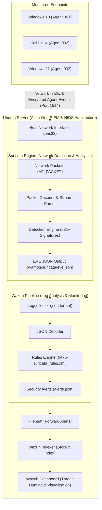

# Suricata NIDS + Wazuh SIEM | SOC Detection Engineering Lab

<p align="center">
  
  
  
  
  
</p>

A hands-on detection engineering and security operations lab demonstrating the deployment, architecture, and integration of **Suricata High-Performance Network IDS** with the **Wazuh SIEM Platform**. Network packets are captured, decoded, and matched against 53,500+ threat signatures in near-real time, normalized into structured EVE JSON telemetry, and correlated inside Wazuh for centralized SOC threat hunting and investigation.

> [!IMPORTANT]
> **Co-Located Single-Server Architecture:** Suricata runs natively on the Wazuh Server. The Wazuh Manager's built-in **Logcollector** daemon monitors Suricata's `eve.json` output in real time using the native JSON log format. A separate, redundant `wazuh-agent` daemon is **not** required on the central server.

---

## Table of Contents

- [1. Executive Summary & Capabilities](#1-executive-summary--capabilities)
- [2. System Architecture & Topology](#2-system-architecture--topology)
  - [2.1 High-Level Architecture Diagram](#21-high-level-architecture-diagram)
  - [2.2 Unified Server Event Pipeline](#22-unified-server-event-pipeline)
  - [2.3 Component Responsibility Matrix](#23-component-responsibility-matrix)
- [3. Monitored Endpoint Fleet](#3-monitored-endpoint-fleet)
- [4. Core Integration & Detection Flow](#4-core-integration--detection-flow)
- [5. SOC Threat Hunting in Wazuh Dashboard](#5-soc-threat-hunting-in-wazuh-dashboard)
  - [5.1 Threat Hunting Queries](#51-threat-hunting-queries)
  - [5.2 Normalized Field Reference](#52-normalized-field-reference)
- [6. Detection Engineering & Operational Boundaries](#6-detection-engineering--operational-boundaries)
- [7. Official References](#7-official-references)

---

## 1. Executive Summary & Capabilities

Modern Security Operations Centers (SOCs) require comprehensive visibility across both endpoint telemetry (EDR/HIDS) and network telemetry (NIDS). This lab establishes a centralized detection and correlation pipeline delivering:

- **High-Speed Network Sniffing:** Multi-threaded packet capture and stream reassembly powered by Suricata's `AF_PACKET` engine.
- **Threat Intelligence Feeds:** Integration with **Emerging Threats Open (ET Open)** and **OISF TrafficID** feeds, compiling over 53,500 active detection signatures.
- **Structured Telemetry Normalization:** Outputting enriched flow, DNS, TLS, HTTP, anomaly, and alert data into Suricata's Extensible Event Format (`eve.json`).
- **SIEM Correlation & Rule Evaluation:** Ingestion by the Wazuh Logcollector and automated parsing through Wazuh's JSON decoder and Suricata ruleset (`0475-suricata_rules.xml`).
- **Enterprise Alert Pipeline:** Seamless delivery via Filebeat into the Wazuh Indexer and interactive visualization in the Wazuh Dashboard.

---

## 2. System Architecture & Topology

### 2.1 High-Level Architecture Diagram

The lab network consists of monitored enterprise endpoints alongside the central Ubuntu security server hosting Suricata and the full Wazuh SIEM stack:

<p align="center">
  
</p>

### 2.2 Unified Server Event Pipeline

All core processing, analysis, indexing, and visualization services run unified on the central server:



### 2.3 Component Responsibility Matrix

| Component | Layer | Role & Responsibility in Pipeline |
|---|---|---|
| **Suricata Engine** | Network IDS | Captures raw frames via `AF_PACKET`, reassembles streams, matches signatures, and writes JSON events to `/var/log/suricata/eve.json`. |
| **Wazuh Logcollector** | Telemetry Ingestion | Built-in manager daemon that continuously monitors `eve.json` and forwards records into the analysis queue. |
| **Wazuh JSON Decoder** | Data Normalization | Extracts nested JSON key-value pairs (`data.alert.*`, `data.src_ip`, `data.dest_ip`, `data.proto`) into searchable fields. |
| **Wazuh Rules Engine** | SIEM Correlation | Evaluates parsed events against `0475-suricata_rules.xml`, assigns alert levels (3–12), and outputs to `/var/ossec/logs/alerts/alerts.json`. |
| **Filebeat** | Transport & Shipping | Ships formatted alert documents over TLS to the Wazuh Indexer. |
| **Wazuh Indexer** | Search & Storage | Distributed OpenSearch-based indexer storing documents in `wazuh-alerts-*` indices. |
| **Wazuh Dashboard** | SOC Visual Interface | Provides real-time event exploration, KQL/Lucene querying, and threat hunting visualization. |

---

## 3. Monitored Endpoint Fleet

| System Name | Operating System | Wazuh Agent ID | Communication Channel | Role |
|---|---|:---:|---|---|
| **`wazuh-server`** | Ubuntu Server 22.04/24.04 | `000` | Local System / Logcollector | Central SIEM & NIDS Host |
| **`WIN11-SOC-HOST`** | Windows 11 Enterprise | `003` | TCP 1514 (AES Encrypted) | Monitored Host / Active |
| **`WIN10-SOC-LAB`** | Windows 10 Pro | `001` | TCP 1514 (AES Encrypted) | Monitored Host |
| **`KALI-SOC-LAB`** | Kali Linux Rolling | `002` | TCP 1514 (AES Encrypted) | Security Testing & Attack Emulation |

---

## 4. Core Integration & Detection Flow

The pipeline operates through a streamlined four-stage data cycle:

```
[ Network Traffic ]
        │
        ▼
(1) Suricata NIDS ────► AF_PACKET Sniffing ──► 53k+ Threat Signatures
        │
        ▼
(2) EVE JSON ─────────► /var/log/suricata/eve.json
        │
        ▼
(3) Wazuh Manager ────► Logcollector ──► JSON Decoder ──► Rules Engine
        │
        ▼
(4) Visualization ────► Filebeat ──► Wazuh Indexer ──► Wazuh Dashboard
```

1. **Traffic Ingestion & Deep Packet Inspection:** Suricata binds directly to the server's network interface (`ens33`) using high-speed `AF_PACKET` capture with hardware frame ring buffers (`tpacket-v3: yes`).
2. **Signature Evaluation & Event Enrichment:** Ingress and egress traffic is compared against Emerging Threats and OISF signatures. Matching events are serialized with comprehensive metadata (flow IDs, payload anomalies, protocol decoders) into `eve.json`.
3. **Local Manager Collection:** The Wazuh Manager ingests the JSON log stream via its native `<localfile>` configuration:
   ```xml
   <localfile>
     <location>/var/log/suricata/eve.json</location>
     <log_format>json</log_format>
   </localfile>
   ```
4. **SIEM Correlation & Indexing:** Wazuh correlates network anomalies with host events, generates standardized security alert objects, and Filebeat transmits them into the Wazuh Indexer for immediate analyst retrieval.

---

## 5. SOC Threat Hunting in Wazuh Dashboard

### 5.1 Threat Hunting Queries

Security analysts can query the `wazuh-alerts-*` data view in the Wazuh Dashboard using Kibana Query Language (KQL) or Lucene syntax:

| Investigation Objective | Query Filter |
|---|---|
| **All Suricata Detections** | `rule.groups: "suricata"` |
| **Local Host Network Alerts** | `agent.id: "000" AND rule.groups: "suricata"` |
| **Specific Rule ID Match** | `rule.id: 86601` |
| **High-Severity Network Detections** | `rule.groups: "suricata" AND rule.level >= 7` |
| **Filter by Source IP** | `data.src_ip: "<target-ip>"` |
| **Protocol Anomaly Detections** | `data.alert.signature: *TLS*` or `data.alert.signature: *Anomaly*` |
| **Specific Threat Signatures** | `data.alert.signature: *GPL*` or `data.alert.signature: *ET*` |

### 5.2 Normalized Field Reference

When Suricata alerts are indexed, Wazuh normalizes the nested JSON keys into standard investigation fields:

| Field Name | Type | Description |
|---|---|---|
| `agent.id` | Keyword | Wazuh agent (`000` corresponds to local Manager) |
| `rule.id` | Keyword | Wazuh rule ID (e.g., `86601` for Suricata alerts) |
| `rule.level` | Integer | Wazuh severity rating (typically 3 to 12) |
| `rule.groups` | Array | Classification tags (`["ids", "suricata"]`) |
| `data.src_ip` | IP | Source IP of the flagged network flow |
| `data.src_port` | Integer | Source transport port |
| `data.dest_ip` | IP | Destination IP of the flagged network flow |
| `data.dest_port` | Integer | Destination transport port |
| `data.proto` | Keyword | Network layer 4 protocol (`TCP`, `UDP`, `ICMP`) |
| `data.alert.signature` | Text | Human-readable name of the triggered signature |
| `data.alert.signature_id` | Long | Unique Suricata Signature ID (SID) |
| `data.alert.category` | Keyword | Threat classification (e.g., `Potentially Bad Traffic`) |
| `data.alert.action` | Keyword | Enforcement disposition (`allowed` or `blocked`) |

---

## 6. Detection Engineering & Operational Boundaries

1. **Virtual Switch Visibility:** In virtualized environments (e.g., VMware Workstation, ESXi, Proxmox), a standard virtual NIC only receives broadcast traffic and unicast traffic addressed to or from that host. To inspect East-West traffic between other virtual machines (e.g., Kali Linux attacking Windows 11), configure a virtual switch with promiscuous mode or set up a dedicated SPAN/port-mirroring session.
2. **Passive IDS vs. Inline IPS:** In this configuration, Suricata operates as a passive **Intrusion Detection System (IDS)** using `AF_PACKET`. Alerts marked with `action: allowed` indicate that traffic matched a signature and was recorded, but was **not dropped**. For active packet blocking (IPS), Suricata must be configured inline with `NFQUEUE` or bridged interfaces.
3. **Telemetry Volume & Storage Hygiene:** Network monitoring produces substantial log volume. Maintain log rotation policies (`/etc/logrotate.d/suricata`) to preserve disk health, and enable full raw archive forwarding (`<logall_json>yes</logall_json>`) only when storage capacity is planned accordingly.

---

## 7. Official References

- [Wazuh Documentation — Network IDS Integration with Suricata](https://documentation.wazuh.com/current/proof-of-concept-guide/integrate-network-ids-suricata.html)
- [Wazuh Documentation — Local Log Data Collection (`localfile`)](https://documentation.wazuh.com/current/user-manual/capabilities/log-data-collection/index.html)
- [Wazuh Documentation — Ruleset and Decoder Architecture](https://documentation.wazuh.com/current/user-manual/ruleset/index.html)
- [Suricata Documentation — Quickstart & Configuration Guide](https://docs.suricata.io/en/latest/quickstart.html)
- [Suricata Documentation — AF_PACKET High Speed Capture](https://docs.suricata.io/en/latest/capture-hardware/af-packet.html)
- [Suricata Documentation — EVE JSON Output Format](https://docs.suricata.io/en/latest/output/eve/eve-json-output.html)
- [Suricata-Update Documentation — Managing Threat Feeds](https://docs.suricata.io/en/latest/rule-management/suricata-update.html)

---

<p align="center">
  <b>SOC Engineering Lab</b> • Crafted for high-fidelity detection engineering and defensive security operations.
</p>
